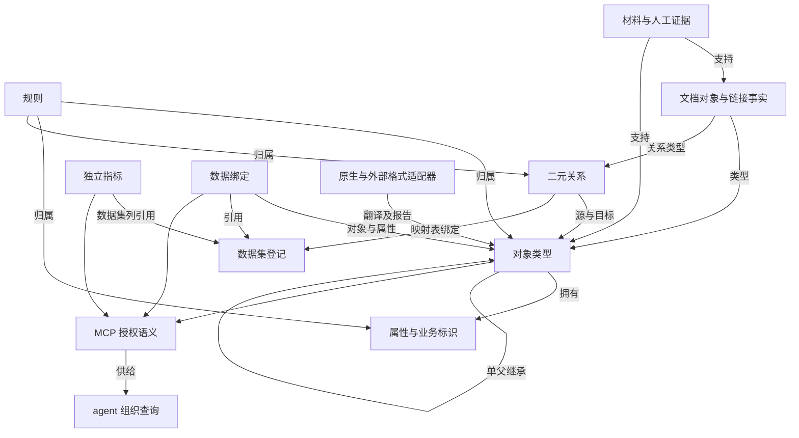

# 核心模型概念

[概念概览](README.md) · [主设计文档 §1–3、§8A、§14](../design/2026-10-14-core-model-and-format-adapters.md)

本文说明 core-1 的目标模型与行为，状态为设计定稿、待实施。JSON 示例中的业务和数据来源均为虚构；片段不是完整导入包，完整包形式见[格式与转换](formats.md)。字段表逐项说明何时填写、空值与默认行为。

## 1. 概述

问“本月完成了多少订单”之前，先要说清什么算订单、什么算完成，以及金额和状态从哪里读取。核心模型保存这些共同含义，让人和 agent 使用同一套业务定义。它也能直接描述汇总表上的计算，例如“代码行日统计”的提交数，不要求先创建一个业务对象。

**我们给的是语义。** 订单、客户等对象描述业务事物，属性保存单个实例的值，关系连接实例，每个指标只引用自己的数据集列，定义这张表的记录怎样计算，数据集和绑定说明数据来源。需要让多次问数沿用相同口径时使用这些定义；只想执行一次临时 SQL 时，不必把每个临时结果都建成对象或指标。平台校验定义和引用，agent 根据授权、问题与引擎组织查询，保持指标算法、固定条件和快照口径。

### 概念关系图



这是解释概念依赖的文档图，不是产品“全局”页面。产品全局采用不画连线的分层概览，展示对象、关系、指标、数据集、文档实例与材料、服务端点及其数量；语义视图采用资源管理器与图，资源管理器包含对象、关系、指标、数据集四类，关系图不画指标节点。

### 页面索引

| 页面 | 主要回答 |
|---|---|
| [对象类型](object-types.md) | 什么是一类业务实体，怎样命名和展示实例？ |
| [属性](properties.md) | 一个对象有什么值，计算属性与指标有什么区别？ |
| [标识](identifiers.md) | 怎样区别同一个与不同的业务实例？ |
| [关系类型](link-types.md) | 对象怎样关联，基数和 JOIN 有什么区别？ |
| [数据集与绑定](datasets-and-binding.md) | 表在哪里，属性来自哪一列？ |
| [继承](inheritance.md) | 子对象属于父对象的范围怎样定义？ |
| [时间与快照](time-and-snapshots.md) | 哪些表是快照、指标按哪个时间归周期、当前与期末取哪一天？ |
| [指标](metrics.md) | 可信聚合口径怎样定义和复用？ |
| [规则](rules.md) | 约束与派生说明属于谁？ |
| [证据与实例](evidence-and-instances.md) | 文档事实怎样保存和追溯？ |
| [查询语义](query-semantics.md) | MCP 返回什么，agent 怎样查数？ |
| [格式与转换](formats.md) | 怎样备份、交换与理解转换损失？ |

Ossie 是语义基准，尽量无损保留；首版未承载能力集中见[主设计 §7 例外表](../design/2026-10-14-core-model-and-format-adapters.md#首版不承载的-ossie-能力)，成功完整转换的条目与原文待补全条目分别报告。

## 2. 字段

| 字段 | 类型 | 填写要求 | 说明 |
|---|---|---|---|
| `schema_version` | 字符串 | 必须提供。 | 此字段固定为 core-1，表示本文定义的模型版本。 |
| `workspace_id` | UUID | 必须提供。 | 此字段引用定义所属工作空间，不承担业务实例标识职责。 |
| `object_types` | 元素数组 | 必须提供，可为空数组。 | 保存对象类型定义，属性和关系通过 id 引用它们。 |
| `properties` | 元素数组 | 必须提供，可为空数组。 | 保存各对象的属性定义，归属通过 owner_type_id 指定。 |
| `link_types` | 元素数组 | 必须提供，可为空数组。 | 保存二元关系定义，两端通过对象 id 指定。 |
| `metrics` | 指标数组 | 必须提供。 | 此数组保存独立的聚合定义，指标与本体并列。 |
| `rules` | 元素数组 | 必须提供，可为空数组。 | 保存归属具体元素的业务约束或派生说明。 |
| `datasets` | 元素数组 | 必须提供，可为空数组。 | 保存物理数据集登记，表位置在此维护。 |
| `mappings` | 元素数组 | 必须提供，可为空数组。 | 保存业务对象到数据集来源和列的绑定。 |
| `material_objects` | 事实数组 | 必须提供，可为空数组。 | 保存从材料或人工确认中得到的对象事实。 |
| `material_links` | 事实数组 | 必须提供，可为空数组。 | 保存文档对象事实之间的二元链接。 |


## 3. 例子

以下是一份字段齐全的最小订单模型草稿，含订单属性、数据集、绑定及金额指标。它可放入原生单文件的 `draft`；字段含义分别见各概念页。

```json
{
  "schema_version": "core-1",
  "workspace_id": "11111111-1111-4111-8111-111111111111",
  "object_types": [
    {
      "id": "00000000-0000-4000-8000-000000001002",
      "name": "订单",
      "technical_name": "sales_order",
      "description": "客户的一次下单\n\n采用指标时保留其固定过滤；完成率的已完成条件仅作用于分子。",
      "synonyms": [
        "销售单"
      ],
      "tags": [
        "核心"
      ],
      "extends": null,
      "evidence": [],
      "title_property_id": "00000000-0000-4000-8000-000000002011",
      "derived_by": []
    }
  ],
  "properties": [
    {
      "id": "00000000-0000-4000-8000-000000002011",
      "owner_type_id": "00000000-0000-4000-8000-000000001002",
      "name": "订单号",
      "technical_name": "order_no",
      "description": "",
      "value_kind": "string",
      "required": true,
      "identifier": true,
      "unique": true,
      "synonyms": [],
      "evidence": []
    },
    {
      "id": "00000000-0000-4000-8000-000000002012",
      "owner_type_id": "00000000-0000-4000-8000-000000001002",
      "name": "金额",
      "technical_name": "amount",
      "description": "含税金额，单位元",
      "value_kind": "decimal",
      "required": true,
      "identifier": false,
      "unique": false,
      "synonyms": [
        "销售额",
        "订单金额"
      ],
      "evidence": []
    },
    {
      "id": "00000000-0000-4000-8000-000000002013",
      "owner_type_id": "00000000-0000-4000-8000-000000001002",
      "name": "状态",
      "technical_name": "status",
      "description": "",
      "value_kind": "string",
      "required": false,
      "identifier": false,
      "unique": false,
      "synonyms": [],
      "evidence": []
    },
    {
      "id": "00000000-0000-4000-8000-000000002014",
      "owner_type_id": "00000000-0000-4000-8000-000000001002",
      "name": "下单时间",
      "technical_name": "ordered_at",
      "description": "",
      "value_kind": "datetime",
      "required": false,
      "identifier": false,
      "unique": false,
      "synonyms": [],
      "evidence": []
    }
  ],
  "link_types": [],
  "rules": [],
  "metrics": [
    {
      "id": "00000000-0000-4000-8000-000000006001",
      "name": "订单金额",
      "technical_name": "order_amount",
      "description": "",
      "synonyms": [
        "销售额",
        "营收"
      ],
      "kind": "simple",
      "aggregation": "sum",
      "measure": {
        "dataset_id": "b7cc4307-1928-522c-a58b-921b2b697d75",
        "column": "amount"
      },
      "filters": [],
      "evidence": [],
      "dataset_id": "b7cc4307-1928-522c-a58b-921b2b697d75"
    }
  ],
  "datasets": [
    {
      "id": "b7cc4307-1928-522c-a58b-921b2b697d75",
      "name": "orders",
      "dialect": "mysql",
      "schema_name": "dw",
      "table_name": "orders",
      "description": "虚构示例数据集。",
      "snapshot_date_column": null,
      "columns": [
        {
          "name": "order_id",
          "physical_type": "varchar",
          "comment": "示例登记列"
        },
        {
          "name": "amount",
          "physical_type": "decimal",
          "comment": "示例登记列"
        },
        {
          "name": "status",
          "physical_type": "varchar",
          "comment": "示例登记列"
        },
        {
          "name": "created_at",
          "physical_type": "datetime",
          "comment": "示例登记列"
        },
        {
          "name": "customer_id",
          "physical_type": "varchar",
          "comment": "示例登记列"
        }
      ]
    }
  ],
  "mappings": [
    {
      "id": "00000000-0000-4000-8000-000000007002",
      "type_id": "00000000-0000-4000-8000-000000001002",
      "fields": {
        "order_no": {
          "kind": "column",
          "source_id": "main",
          "column": "order_id"
        },
        "amount": {
          "kind": "column",
          "source_id": "main",
          "column": "amount"
        },
        "status": {
          "kind": "column",
          "source_id": "main",
          "column": "status"
        },
        "ordered_at": {
          "kind": "column",
          "source_id": "main",
          "column": "created_at"
        }
      },
      "binding_mode": "independent",
      "sources": [
        {
          "id": "main",
          "key_columns": [
            "order_id"
          ],
          "dataset_id": "b7cc4307-1928-522c-a58b-921b2b697d75"
        }
      ],
      "membership_source_id": null,
      "inherited_link_bindings": {}
    }
  ],
  "material_objects": [],
  "material_links": []
}
```

agent 读取这份语义后，回答“订单总金额”可形成以下参考查询；是否增加问题中的时间范围由 agent 决定。

```sql
SELECT SUM(o.amount) AS order_amount
FROM dw.orders AS o;
```

界面中，“全局”显示元素类别与数量；点击指标层进入语义视图的指标筛选。在语义视图筛选到“指标”，点击订单金额查看完整口径；对象详情是否按绑定推导展示相关指标由工程和原型阶段决定，模型不保存该关联。

## 4. 建模建议

| 订单号 | 状态 | 金额 |
|---|---|---|
| O-1 | 已完成 | 100 |
| O-2 | 已取消 | 50 |

正例：先定义完成订单数和全部订单数，再求完成率，得到 1/2=0.5。

反例：把“已完成”加到公共筛选，分母也只剩 O-1，错误结果为 1。

### 建模流程

1. 先写业务定义。说明订单、客户等对象分别代表什么，再定义属性、业务标识与实例标题。
2. 定义二元关系。多方共同发生的事实建中间对象，配对有数量或日期时把它们放在中间对象上。
3. 登记数据集。写明方言、命名空间、表名、说明和可空快照日期列，再用绑定引用数据集和列。
4. 决定实例范围。普通对象由主表决定范围；有绑定父对象必须覆盖所有子实例，虚拟父对象按具体子对象实例并集理解。
5. 选择一个登记数据集，仅用该数据集的列定义指标及时间口径。优先 simple、ratio，复杂本数据集算法保存 expression；其他数据集条件在 agent 查询时沿本体关系筛选。逐行比率列仍是属性。
6. 添加具体元素的规则、说明、同义词及证据。通过提案审阅、接受和发布，让 agent 消费已发布语义。

正例：先定义“完成率 = 已完成订单数 / 全部订单数”，再让 agent 按月查询。反例：把完成状态放入所有查询的公共 WHERE，导致分母也只剩已完成订单。没有现成指标时，agent 可以依据模型组合查询，但须解释所用口径。

## 5. 校验与限制

主设计文档是字段与行为的规范来源。这组概念页不新增持久化字段、查询执行器或外部产品兼容承诺。JSON 展示字段结构与合法引用方式；静态例子不代表 core-1 schema、适配器或 UI 已实现。

技术名采用字母或下划线开头的 ASCII 标识符，允许 SQL 保留字，由 agent 在物理 SQL 中正确引用；对象技术名在工作空间内忽略大小写唯一。属性和关系共享所属对象的命名空间。改技术名按 id 依赖更新路径，不能全局替换字符串。

平台校验声明、依赖与结构，不扫描数据库证明实例覆盖、唯一性或关联基数。权限同时作用于定义投影、物理来源、数量、证据与缓存；数据集登记不能绕过映射读取权限。

## 6. 与 Palantir Foundry、Microsoft Fabric IQ、Apache Ossie 的对照

核查日期：2026-10-15。以下依据官方公开文档；Fabric IQ 的本体功能处于预览阶段。概念对应不表示字段、执行能力或往返行为相同，未实测外部租户。

| core-1 | Palantir Foundry | Microsoft Fabric IQ | Apache Ossie |
|---|---|---|---|
| 对象、属性、二元关系 | [Object / Link types](https://www.palantir.com/docs/foundry/object-link-types/type-reference) 是相近业务建模概念。 | [Entity / Relationship types](https://learn.microsoft.com/en-us/fabric/iq/ontology/overview) 是相近概念。 | [EntityType 与 relationships](https://github.com/apache/ossie/blob/main/ontology/ontology.md)；其关系还允许一元和多元。 |
| 数据集与绑定 | [创建对象时选择 backing datasource](https://www.palantir.com/docs/foundry/object-link-types/create-object-type)。 | [绑定](https://learn.microsoft.com/en-us/fabric/iq/ontology/how-to-bind-data)连接定义与来源。 | ontology 与 semantic_model 分层，用 mappings 连接；内嵌映射已弃用。 |
| 继承 | [Interface](https://www.palantir.com/docs/foundry/interfaces/interface-overview) 是抽象接口，不等于具体对象单父继承。 | [单父继承](https://learn.microsoft.com/en-us/fabric/iq/ontology/how-to-use-inheritance)不继承普通关系与绑定。 | extends 支持更宽表达；本平台只保留单父。 |
| 指标 | [对象集合聚合](https://www.palantir.com/docs/foundry/api/ontology-resources/objects/aggregate)；本体没有同构可复用指标定义。 | [定义协议](https://learn.microsoft.com/en-us/rest/api/fabric/articles/item-management/definitions/ontology-definition)为顶层 model.metrics[]，[操作页](https://learn.microsoft.com/en-us/fabric/iq/ontology/how-to-use-metrics)按 measure 所在表对应实体展示。 | [开放语义交换规范 OSI（Open Semantic Interchange）中的指标 Metric，用于交换计算定义](https://github.com/apache/ossie/blob/main/core-spec/spec.yaml)保存表达式。 |
| 规则 | [Submission criteria](https://www.palantir.com/docs/foundry/action-types/submission-criteria)有执行语义；与本平台只保存的规则不同。 | [业务规则](https://learn.microsoft.com/en-us/fabric/iq/ontology/how-to-use-rules)为自然语言上下文。 | requires / derived_by 挂在概念或关系；不支持的语义按例外表报告。 |
